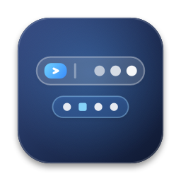

<div align="center">
    
    <h1>MacBar</h1>
    <p><strong>Native macOS menu bar manager — improved fork of <a href="https://github.com/jordanbaird/Ice">jordanbaird/Ice</a> with macOS 27 support.</strong></p>
</div>

## Overview

MacBar lets you organize, hide, search, and style your macOS menu bar items cleanly on macOS 14 through macOS 27 (including native "Allow in the Menu Bar" hiding, Accessibility-based item inspection, and the Floating Bar).

## Improvements over upstream `jordanbaird/Ice`

- **Full macOS 27 (`MenuBarAgent`) support**: Native `trackedApplications` hiding with crash-safe auto-restore, Assessment Mode fallback, Accessibility item discovery, helper-app bundle resolution, click bridge on a dedicated thread, notch overflow handling, and 45s launch grace window.
- **macOS 26/27 stability & crash fixes**:
  - Screen Recording permission detection via `ScreenCaptureKit` (`SCShareableContent`) instead of the broken window-title heuristic.
  - Safe `NSScreen.displayID`, `NSBezierPath.drawShadow`, and `CGImage.averageColor` guards against nil/zero-pixel crashes.
  - Ad-hoc XPC support in `MenuBarItemService` so locally signed builds work without a Team Identifier.
  - Search Panel clicks on hidden items routed via `ItemClicker27` on macOS 27.
  - Wallpaper & split-shape overlay appearance support for `WindowManager` on macOS 27, fullscreen hiding, screen-parameter panel cleanup, and multi-display bounds validation.
  - Window/hotkey observer leak fixes and stale item image pruning.
- **Zero external dependencies & clean local build**: Replaced external SwiftPM packages (`AXSwift`, `LaunchAtLogin`, `CompactSlider`, `Semaphore`, `Ifrit`, `Sparkle`) with native Apple/Swift implementations so MacBar builds completely offline, rebranded as `MacBar` (`com.macbar.MacBar`) with a custom native app icon and DMG packager.

## Building & Packaging

- **Run unit tests**:
  ```sh
  swift test
  ```
- **Build & install locally to `/Applications/MacBar.app`**:
  ```sh
  ./Scripts/install.sh
  ```
- **Build release `.app` and `dist/MacBar.dmg`**:
  ```sh
  ./Scripts/build_dmg.sh
  ```

## License

MacBar is licensed under the [GNU General Public License v3.0](LICENSE), based on [Ice](https://github.com/jordanbaird/Ice) by Jordan Baird.
